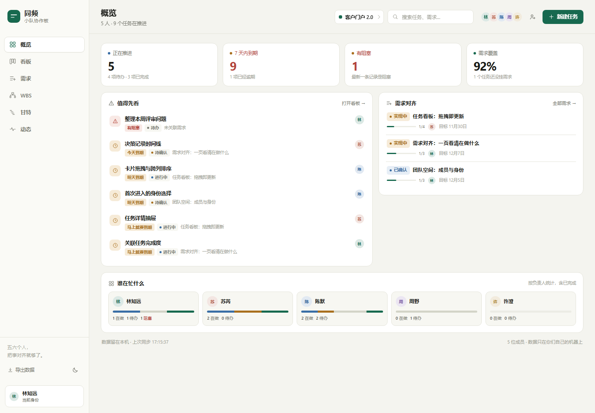
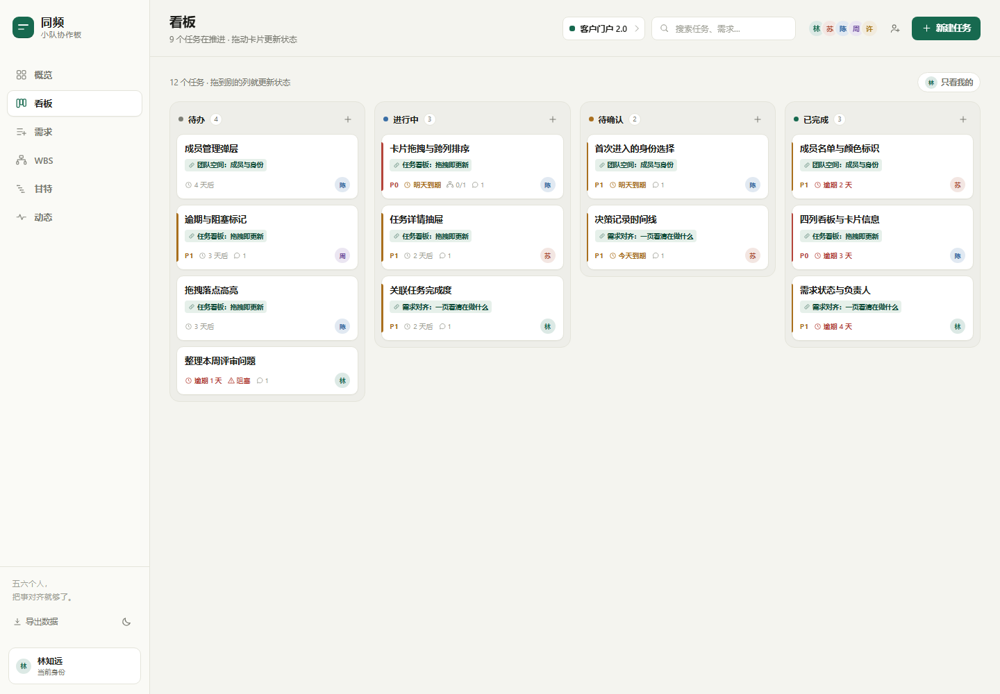
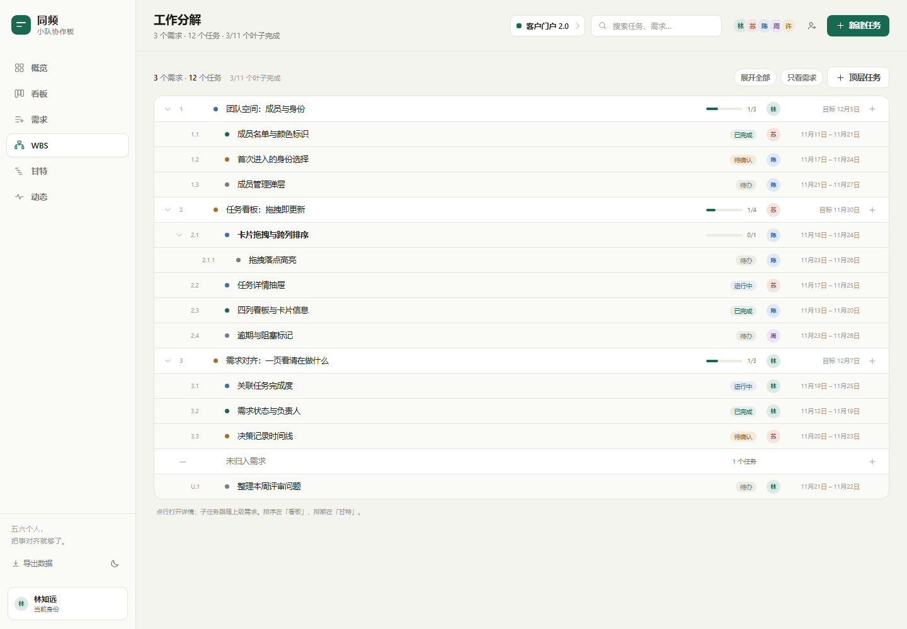
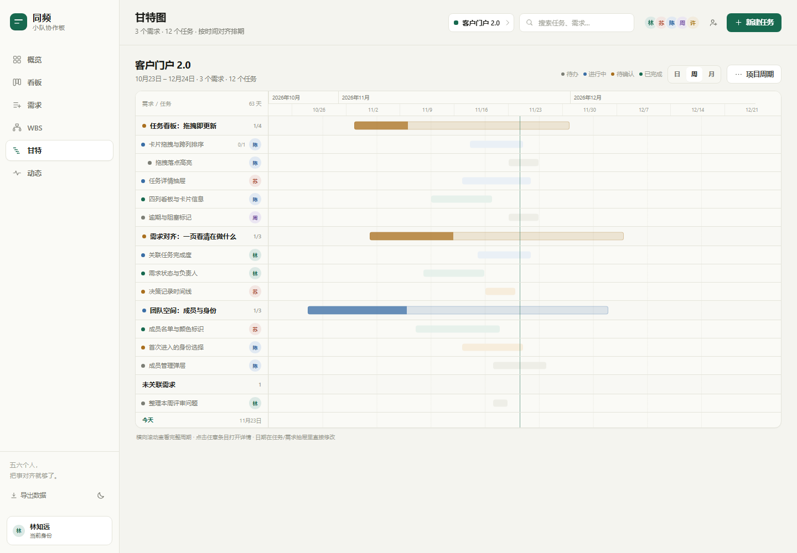
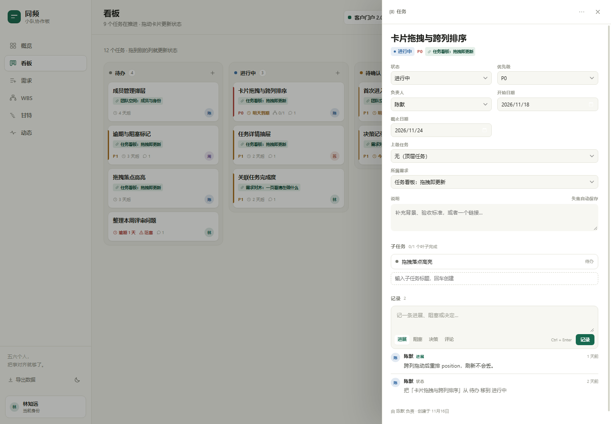

# 同频 · 小队协作板

一个给 **5–6 人小组** 用的轻量项目协作工具：WBS 把交付物拆到工作包，看板推进任务、需求页对齐目标、甘特图看整体排期、记录流更新进度。

单文件 SQLite、零第三方依赖、一条命令启动。没有账号体系，没有后台，没有构建步骤。一个实例可以放多个项目，项目经理在顶栏一键切换。



## 为什么做它

小组协作通常卡在两件事：**进度不透明**，以及 **做的和说好的对不上**。

大而全的工具（Jira、飞书项目）把这两件事都解决了，但配置和流程本身就是负担；纯文档又缺少推进感。同频只保留四样东西：

- **需求**：要解决什么问题，谁负责，现在什么状态。
- **任务**：具体做什么，挂在哪个需求下，卡在哪一列、从哪天到哪天；可以继续往下拆子任务。
- **记录**：一条进展、一个阻塞、一次决定，直接写进对象的时间线。
- **项目**：一件事一条时间线。需求、任务和进展都留在各自项目里，互不打扰。

WBS 负责“拆得开”，看板负责“动起来”，需求页负责“对得上”，甘特图负责“排得开”，概览负责“一眼看到风险”。

## 快速开始

要求：Python 3.9+（开发环境 3.13）。不需要 Node，不需要数据库服务。

**先看演示数据：**

- Windows：双击 `start-demo.bat`，或执行 `python app.py --demo --open`
- macOS / Linux：`./start-demo.sh`

浏览器会打开 `http://127.0.0.1:8765`，内置 5 位成员、2 个项目、6 个需求、21 个任务的示例数据。

**正式使用（空库）：**

- Windows：双击 `start.bat`，或执行 `python app.py --open`
- macOS / Linux：`./start.sh`

第一次进入会引导添加成员。之后把终端打印的局域网地址（如 `http://192.168.1.8:8765`）发给组员即可。

常用参数：

```bash
python app.py --demo          # 仅在空库时载入示例数据
python app.py --port 9000     # 换端口
python app.py --host 127.0.0.1  # 只允许本机访问
python app.py --db D:/data/team.db  # 指定数据文件
```

## 用法

**先选身份。** 右上角头像或侧栏底部选择“我是谁”，存在浏览器本地。没有密码，换人换身份即可。

**切项目。** 顶栏左上角是项目切换器。一个人同时跟几个项目时，在这里切换，看板、需求、WBS、甘特和动态都会限定在当前项目内。菜单里可以新建项目、改项目名称/周期/颜色；只有在项目里没有需求和任务时才能删除。

**看板。** 四列：待办 / 进行中 / 待确认 / 已完成。拖动卡片改状态和顺序；拖不动或想精确落位时，用卡片右上角菜单里的“移动到”。列底部可直接快速添加任务。

**WBS 拆解。** “工作分解”页把当前项目的需求、任务按树展开：需求是一级交付物，任务可以继续挂子任务，层级不限。点行右侧的 `+` 直接输入标题回车，就能在需求下加任务、在任务下加子任务；子任务自动跟随上级的需求和项目。父任务显示子任务的完成度（只按叶子任务统计，避免父子重复计数）。拖排序仍在看板，排期仍在甘特；删除父任务会连同整棵子树和它们的记录一起删除。

**需求。** 顶部按状态筛选，每条显示负责人和关联任务完成度。新建任务时可以挂到需求下，也可以从需求详情里直接输入标题回车创建。需求删除后，任务会保留但解除关联。

**甘特图。** 按需求分组展示整体排期：需求条显示自身周期和完成度，任务条显示起止日期，今天有一条竖线。支持日 / 周 / 月缩放；没填日期的任务会收进“未排期任务”，补上日期就回到时间轴。任务和需求的“开始日期 / 截止日期”在右侧抽屉里改，改完时间条立即更新。

**记录与进度。** 打开任意任务或需求，在底部写一条记录并选择类型：进展 / 阻塞 / 决策 / 评论。状态、负责人、需求关联变化会自动写入系统记录。概览里的“有阻塞”“快到期”就是从这些数据算出来的。

**其他。** 顶部搜索会跨视图查找当前项目的任务和需求；右上角可切换明暗主题；侧栏“导出 JSON”用于备份或迁移。

快捷键：`Ctrl/Cmd + Enter` 提交记录，`Esc` 关闭抽屉/弹窗/菜单。









## 数据与备份

所有数据在 `data/pm.db` 一个 SQLite 文件里（WAL 模式会伴随 `-wal`/`-shm`）。

- **备份**：停止服务后复制整个 `data/` 目录，最稳妥。
- **迁移**：把 `data/` 拷到新机器同目录，再启动。
- **导出**：页面里的“导出 JSON”，或访问 `/api/export`，会下载一份可读的完整快照。

数据库结构只有六张表：`meta`（版本号）、`members`、`projects`、`requirements`、`tasks`、`entries`。任务的 `parent_id` 指向同表的上一条任务，用来表达子任务；没有单独的 WBS 表。想二次开发或写脚本，直接读它就行。旧版本数据库启动时会自动补列（包括 `tasks.parent_id`），并把没有归属的数据放进“默认项目”。

## HTTP API

前后端就是这一套 JSON 接口，页面每 5 秒拉一次 `/api/state`，版本号（`rev`）变化才重绘。

| 方法 | 路径 | 说明 |
| --- | --- | --- |
| GET | `/api/state` | 全量状态：项目、成员、需求、任务、最近 400 条记录、`rev` |
| GET | `/api/entries?entity_type=task&entity_id=3` | 某个对象的完整记录 |
| GET | `/api/export` | 下载 JSON 快照（含项目） |
| GET | `/api/health` | 健康检查 |
| POST | `/api/projects` | 新建项目 |
| PATCH | `/api/projects/{id}` | 改项目名称/说明/周期/颜色 |
| DELETE | `/api/projects/{id}` | 删除空项目（有需求或任务时拒绝） |
| POST | `/api/members` | 新建成员 |
| PATCH | `/api/members/{id}` | 改成员名/颜色 |
| POST | `/api/requirements` | 新建需求 |
| PATCH | `/api/requirements/{id}` | 改需求字段 |
| DELETE | `/api/requirements/{id}` | 删除需求（任务保留并解除关联） |
| POST | `/api/tasks` | 新建任务；可选 `parent_id` 表示子任务 |
| PATCH | `/api/tasks/{id}` | 改任务字段（含 `parent_id`；状态变化会写系统记录） |
| DELETE | `/api/tasks/{id}` | 删除任务及其整棵子树和记录 |
| POST | `/api/reorder` | 提交看板列顺序 `{columns: {status: [task_id...]}}` |
| POST | `/api/entries` | 写一条记录 `{entity_type, entity_id, kind, body, actor_id}` |

所有写操作返回最新完整状态；新建类接口额外返回 `created_id`。写操作接受 `actor_id`，服务端校验成员存在（不做权限判断）。新建需求/任务必须带 `project_id`；任务关联的需求必须属于同一项目；日期会校验开始不晚于截止。子任务的 `parent_id` 必须属于同一项目，其需求跟随上级任务；移动任务时会拒绝把任务挂到自己的后代下面，避免成环。

## 目录

```text
team-board/
├─ app.py            # 服务端：HTTP + SQLite + 静态文件 + 示例数据
├─ web/
│  ├─ index.html     # 单页骨架与图标 sprite
│  ├─ style.css      # 设计与响应式（含深色主题）
│  ├─ app.js         # 全部交互，原生 JS，无构建
│  └─ favicon.svg
├─ start.bat / start.sh        # 正式使用
├─ start-demo.bat / start-demo.sh  # 演示数据
├─ data/             # 运行时生成，已 gitignore
└─ shots/            # 截图
```

## 参考过的开源项目

设计时刻意对照了几个“轻但完整”的项目，避免闭门造车：

- [Kanboard](https://kanboard.org/)：极简看板、自托管、SQLite。借鉴它“功能克制但闭环”的产品取向——不做权限矩阵和插件体系，也能把事推完。
- [Vikunja](https://vikunja.io/)：Go + Vue，默认 SQLite，同一批任务可切换列表/看板/甘特/表格。受它启发，这里用概览、看板、需求、WBS、甘特、动态六个视角看同一份数据，而不是做六套功能。
- [Planka](https://planka.app/)：卡片式看板的拖拽与右侧详情抽屉。交互节奏参考了它；实现上使用浏览器原生拖放，并保留“移动到”菜单作为兜底。
- [Focalboard](https://www.focalboard.com/)：可独立部署的团队看板，把任务详情集中在一个面板里编辑。抽屉里的字段编辑与自动保存借鉴了这种“少跳页”的思路。
- [trackfw](https://pypi.org/project/trackfw/)：ADR → REQ → ROADMAP → kanban 的治理链。它让“决策”和“需求”成为一等对象；这里把需求做成任务的上游，并允许把决策直接记进时间线。

没有直接复用它们的代码；参考的是信息架构与交互取舍。

## 设计取舍

**为什么零依赖。** 标准库 `http.server` + `sqlite3` 足够支撑 5–6 人、每天几百次读写。少一层框架，就少一份升级、部署和排查成本。

**为什么不做登录。** 小组成员之间默认互信，账号密码带来的收益低于它带来的摩擦。身份只用于标注“谁写的”，不是安全边界。**因此请只在内网或本机使用，不要直接暴露到公网。**

**为什么用轮询。** 5 秒一次全量状态，配合 `rev` 判断是否重绘，比 WebSocket 少很多状态管理；对“更新进度”这个频率完全够用。

**为什么需求要独立存在。** 如果只有任务，很容易出现“做完了很多事，但没人说得清为什么做”。需求页把完成度和负责人摆在一起，周会时可以直接对着它对齐。

**为什么项目只是数据分区。** 项目经理常同时跟几个项目，但干活的是同一批人。项目因此不引入成员邀请和权限，只做数据归属和视图隔离：切项目就是换一组需求、任务和记录，成员列表始终共用。

**为什么 WBS 复用任务表。** 子任务本质上还是任务：要有状态、负责人、日期、记录，也要出现在看板和甘特里。单独建一张 WBS 表会让同一件事在两处维护。这里用 `tasks.parent_id` 做自引用，层级、汇总进度和级联删除都由同一套数据推导，不为 WBS 增加第二套真相。

## 已知限制

- 无鉴权、无 CSRF 防护、无 HTTPS：仅限可信内网。
- 轮询有最多 5 秒延迟，不是实时协同；两人同时拖同一张卡时，后提交者覆盖。
- SQLite 单文件写入并发有限，适合小团队，不适合高频自动化。
- 没有附件、通知、权限角色；多项目共用一个成员列表，不能按项目隔离可见性。
- WBS 只拆任务，不自动改父任务状态；父任务进度是按叶子任务算出来的展示值。
- 身份可自由切换，记录里的作者只是“当时选择的身份”，不构成审计。

这些限制是刻意的：需要更重的协作时，应该换工具，而不是把这个工具继续加大。

## 开发

改前端不需要构建，刷新即可；改 `app.py` 需要重启服务。

```bash
node --check web/app.js          # 前端语法检查（可选）
python -m py_compile app.py      # 后端语法检查
```